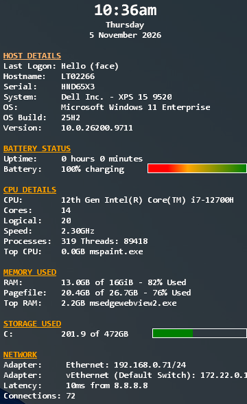
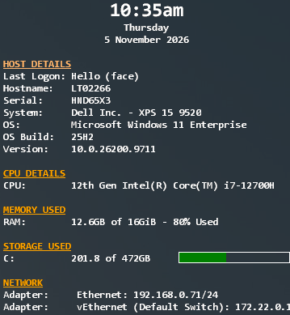

# DesktopInfo — Custom Configurations and Deployment

This repository contains two customised configurations and a PowerShell installation script for **DesktopInfo**, the Windows desktop system-information utility developed by **Glenn Delahoy**.

DesktopInfo displays useful device and operating-system information directly on the Windows desktop. The configurations provided here are intended for Windows device deployments, including packaging for Microsoft Intune.

> [!IMPORTANT]
> **Always download the latest DesktopInfo release from the [official website](https://www.glenn.delahoy.com/desktopinfo/) before preparing a new deployment package.** Do not assume the executable stored in this repository is the latest version.

## Official resources

- **Download / latest version:** https://www.glenn.delahoy.com/desktopinfo/
- **Documentation:** The official download includes the full documentation in PDF format.
- **Discussion and support forum:** https://www.glenn.delahoy.com/community/desktop-info/

DesktopInfo is a third-party application by Glenn Delahoy. This repository provides customised configuration files and deployment material, not the upstream application source code.

## Supported configurations

Two configuration variants are maintained:

| Variant | Repository file | Description |
| --- | --- | --- |
| **Full** | `desktopinfo.ini` | Comprehensive desktop information display |
| **CutDown** | `desktopinfo-cutdown.ini` | Reduced display showing the essentials |

### Full

The Full configuration includes:

- Current time and date
- Last sign-in method, hostname, serial number, device manufacturer and model
- Windows operating system, display version and build information
- Uptime and battery status (where available)
- CPU details, core and logical processor counts, clock speed, process/thread counts and top CPU-consuming process
- Physical memory, pagefile usage and top memory-consuming process
- Logical drive capacity and usage indicators
- Network adapters, latency test to `8.8.8.8` and network connection count

### CutDown

The CutDown configuration retains:

- Current time and date
- Last sign-in method, hostname, serial number, device manufacturer and model
- Windows operating system, display version and build information
- CPU model
- Physical memory usage
- Logical drive capacity and usage indicators
- Network adapter details

Both configurations use a single-column layout, Consolas font, colour-coded sections and a semi-transparent display.

## Screenshots

| Full configuration | CutDown configuration |
| :---: | :---: |
|  |  |

The **Full** layout provides detailed system information, while **CutDown** keeps the display compact with the essentials.

## Configuration file naming — important

**DesktopInfo must use the filename `desktopinfo.ini` for the selected configuration in this deployment.**

- **Full:** Use the repository's `desktopinfo.ini` as supplied.
- **CutDown:** Copy `desktopinfo-cutdown.ini` into your packaging folder and **rename the copy to `desktopinfo.ini` before packaging**.

Do not package both variants as competing active configurations. Keep the original repository files unchanged so both versions remain available for future builds.

## Preparing a deployment package

1. Download the latest release from the [official DesktopInfo website](https://www.glenn.delahoy.com/desktopinfo/).
2. Extract the downloaded release.
3. Prepare a clean source folder containing the latest `DesktopInfo.exe`, `DesktopInfo.ps1`, the required `DesktopInfo.lnk` startup shortcut and the chosen configuration.
4. For **Full**, include `desktopinfo.ini`. For **CutDown**, copy `desktopinfo-cutdown.ini` and rename the copy to `desktopinfo.ini`.
5. Ensure that the packaging folder contains only the files intended for deployment. Include any additional files required by the particular upstream release.
6. Package the prepared folder using your normal deployment process, such as the Microsoft Win32 Content Prep Tool for an Intune Win32 app.

**Repeat the official download step whenever creating a new package or updating the deployed version.**

## Installation

The repository includes [`DesktopInfo.ps1`](DesktopInfo.ps1), which:

1. Creates `%ProgramData%\DesktopInfo` if it does not exist.
2. Copies files from the script's **current working directory** into that folder, excluding files with the `.ps1` extension.
3. Creates or updates `DesktopInfo.lnk` targeting `%ProgramData%\DesktopInfo\DesktopInfo.exe` (overwriting the copied shortcut).
4. Copies `DesktopInfo.lnk` into the **All Users Startup** folder at `%ProgramData%\Microsoft\Windows\Start Menu\Programs\Startup`.

**Include `DesktopInfo.lnk` in the packaging source.** The current script also recreates this shortcut during installation before copying it into Startup, so the packaged shortcut is not preserved unchanged.

The installation script does **not** directly launch DesktopInfo. The Startup shortcut starts it at a subsequent user sign-in; **a sign-out/sign-in or reboot may be required** before the display appears.

Run the installer from the prepared package source directory with appropriate permissions to write to ProgramData and the common Startup folder. For example:

```powershell
powershell.exe -NoProfile -ExecutionPolicy Bypass -File .\DesktopInfo.ps1
```

> [!NOTE]
> The existing script copies from the current working directory rather than automatically resolving the directory containing the script. Ensure your deployment command runs with the package source as its working directory. Also avoid including unnecessary files in the source folder, as non-`.ps1` files are copied to the installation directory.

## Microsoft Intune deployment

A **Win32 app** package can be built from the prepared source folder.

| Setting | Suggested configuration |
| --- | --- |
| App type | Windows app (Win32) |
| Install command | `powershell.exe -NoProfile -ExecutionPolicy Bypass -File .\DesktopInfo.ps1` |
| Install behaviour | System |
| Detection rule type | File |
| Detection path | `%ProgramData%\DesktopInfo` |
| File or folder | `DesktopInfo.exe` |
| Detection method | File or folder exists |

### Optional version-based detection

If you want Intune to distinguish between releases, use a **file version** detection rule for `DesktopInfo.exe` instead of a simple existence check. Confirm the version metadata in the particular official executable before configuring a version comparison.

A file-exists rule confirms only that the executable is present; it does not establish that the correct configuration was copied, that the Startup shortcut exists or that the latest release is installed.

### Updating an existing deployment

When updating the package, download the current upstream release, select the appropriate configuration, rebuild the Win32 package and review the detection rule. A simple file-exists detection rule may already be satisfied on devices with an older version; use version-aware detection when an update must be enforced.

## Repository files

| File | Purpose |
| --- | --- |
| `DesktopInfo.exe` | DesktopInfo executable currently stored in the repository; check upstream for newer releases |
| `DesktopInfo.ps1` | Copies deployment files and configures startup |
| `DesktopInfo.lnk` | Required startup shortcut included in the package; the installer recreates it and copies it to the All Users Startup folder |
| `desktopinfo.ini` | Full configuration |
| `desktopinfo-cutdown.ini` | CutDown configuration; rename a copy before packaging |
| `README.md` | Deployment and configuration instructions |

## Troubleshooting

- **Nothing appears after installation:** Sign out and back in, or reboot, then check that the shortcut exists in the common Startup folder.
- **Wrong layout:** Check that the selected configuration was packaged under the exact name `desktopinfo.ini`.
- **Files are missing:** Check the working directory used when running `DesktopInfo.ps1` and verify the contents of `%ProgramData%\DesktopInfo`.
- **Intune reports installed but the expected version is absent:** Review the detection rule; file-exists detection does not distinguish versions.
- **Configuration options or behaviour have changed:** Check the [DesktopInfo forum](https://www.glenn.delahoy.com/community/desktop-info/).

## Credits

**DesktopInfo** is developed by [Glenn Delahoy](https://www.glenn.delahoy.com/desktopinfo/). All credit for the underlying application belongs to its author. The configurations and deployment script in this repository are custom deployment resources.
